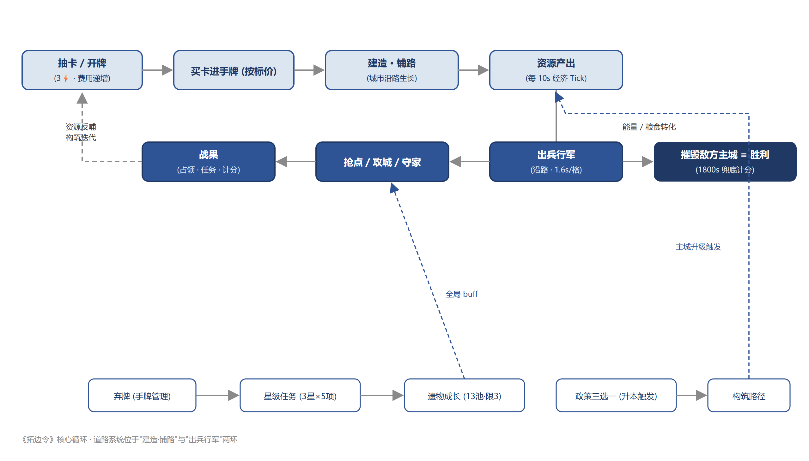
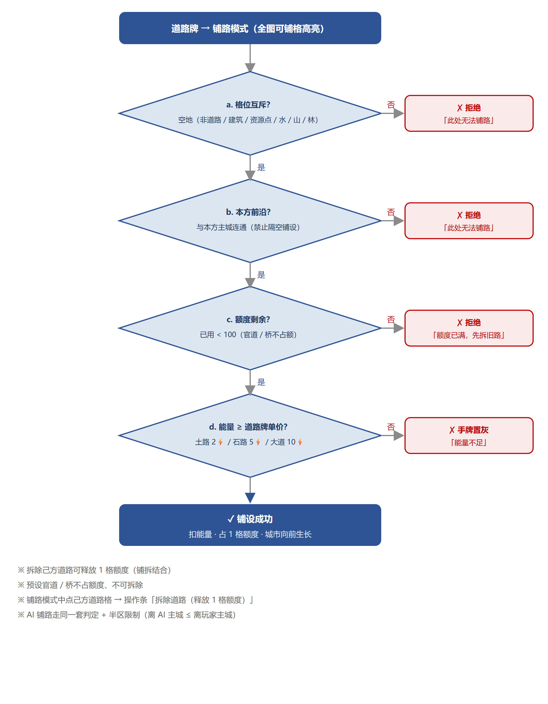

# 系统策划案 · 道路系统

> 项目：《卡牌建城》（工作名）· 1v1 轻策略卡牌对战
> 文档版本：v1.3　·　写作日期：2026-10-11
> 文档目的：完整定义道路系统的功能规则、配置参数与资源需求，作为程序实现、美术产出、QA 验收的基准文档。

---

## 一、版本日志

| 版本号 | 修改内容 | 修改日期 | 修改人 |
|---|---|---|---|
| v1.0 | 增加道路系统：铺路 / 行军 / 官道路基 | 2026-09-26 | 潘睿喆 |
| v1.1 | 铺路改为「开垦旧官道」叙事；新增官道开垦偏好与路面表现规范 | 2026-10-03 | 潘睿喆 |
| v1.2 | 新增道路额度（每方 100 格）与拆路释放；玩家铺路增加前沿限制 | 2026-10-10 | 潘睿喆 |
| v1.3 | AI 铺路改主干式算法；递增单价经济约束实测后默认关闭（机制保留） | 2026-10-10 | 潘睿喆 |

---

## 二、系统说明

### 2.1 设计目的

1. **让城市有骨架**：建筑必须沿道路生长，城市从主城沿路网向外长成一片，玩家的每次铺路都在决定城市的形状；
2. **让战争有血管**：军队只能沿道路行军，进攻路线可被预判、可被拦截，"修到哪、打到哪"；
3. **给扩张一个成本出口**：抢夺远处资源点必须先修路抵达，地图扩张从"免费移动"变成"持续投资"；
4. 一句话总纲：**道路是城市的骨架，也是战争的血管。**

### 2.2 名词定义

| 名词 | 定义 |
|---|---|
| 道路格 | 已铺设道路的地图格，双方共用一套路网（A 方铺设的道路 B 方同样可通行） |
| 官道路基 | 底图上描绘的旧官道走向（99 格，含 2 座桥），是叙事层的"帝国旧官道"；在官道格上铺路称为"开垦" |
| 铺路前沿 | 从本方主城出发、沿可通行格 BFS 蔓延后，紧邻前沿的可铺格集合；**铺路必须沿本方前沿生长**，禁止隔空铺设 |
| 道路额度 | 每方主动铺设的道路格数上限（预设官道/桥不占额度）；拆路可释放额度 |
| 城门缺口 | 主城四邻最多 2 格被己方建筑占据、永远留缺口的保护规则（防自封要塞）；缺口同样不可被敌方铺路封死 |

### 2.3 系统功能列举

- 铺路（道路卡 → 放置模式 → 点地图铺设）
- 道路类型与价格（土路 / 石路 / 大道）
- 道路额度管理（额度校验 / HUD 显示 / 铺满提示）
- 拆路（拆除己方道路、释放额度；预设官道与桥不可拆）
- 官道开垦（官道格偏好 / 开垦叙事 / 机制与普通铺路一致）
- 行军与道路（沿路寻路 / 逐格推进 / 粮耗 / 粮尽停军）
- 占领物流点自动铺路（免费、双方向）
- AI 铺路（目标锁定 / 主干式寻径 / 半区限制 / 节奏控制）

### 2.4 功能需求说明

#### 一、功能入口

玩家从手牌打出**道路牌**进入铺路模式（区别于建筑牌：建筑进入放置模式）。铺路模式下：
1. 全图所有可铺格高亮显示（金框呼吸）；
2. 点击可铺格即铺设一格并扣费，模式保持（一张多格道路牌可连点铺完所含格数，或 Esc / 点击不可铺格退出，剩余格数作废）；
3. 铺路模式下点选己方道路格 → 弹出操作条「拆除道路（释放 1 格额度）」。

#### 二、功能规则

**1. 铺路合法性判定（按顺序执行，任一不通过即不可铺）**

- 步骤 a. 格位互斥校验：目标格必须是空地。以下格不可铺：已有道路、建筑占格（含 2×2 建筑的整块占地）、资源点、水域（桥格除外，桥由底图预设）、山、森林；
- 步骤 b. 连通性校验：目标格必须在本方铺路前沿上（等价于：与本方主城连通的路网/己方建筑/主城四向相邻）。**禁止隔着敌方主城、隔着无路区域铺设**；
- 步骤 c. 额度校验：本方已用额度 < 道路额度上限（100）。预设官道与桥为地图初始数据，**不占额度、不受额度校验影响**；
- 步骤 d. 资源校验：能量 ≥ 道路牌单价（见配置表 3-1）。

**2. 道路类型（三种道路牌只影响一次铺设的格数，不影响行军速度）**

| 道路牌 | 价格 | 铺设格数 | 解锁条件 |
|---|---|---|---|
| 土路牌 | 2⚡ | 1 格 | 开局可用 |
| 石路牌 | 5⚡ | 3 格 | 主城 Lv2 |
| 大道牌 | 10⚡ | 5 格 | 主城 Lv3 |

**3. 道路额度**

- a. 每方额度上限 100 格（可配置），双方独立计算、互不占用；
- b. HUD 常驻显示「道路 N/100」，达到 90% 变色预警，铺满后铺路提示改为「额度已满，先拆旧路」；
- c. 拆除 1 格己方道路 → 释放 1 格额度，可立即再铺；
- d. 预设官道与桥不可拆除、不占额度（它们属于"帝国旧官道"，不是玩家财产）；
- e. 占领物流点后自动铺设的道路**同样占用本方额度**（免费铺、不免费占额）。

**4. 官道开垦**

- a. 官道路基共 99 格（含 2 座桥格），由底图绘制、地图初始数据登记；
- b. 在官道格上铺路，机制与普通铺路**完全一致**（合法性 / 价格 / 额度全部相同）；
- c. 差异仅两处（叙事 + 寻径偏好）：① 表现为"清理杂草、修复旧官道"，官道格铺成后贴回底图真官道贴图；② AI 与自动化寻径中，官道格的移动代价按 0.5 计（普通可铺格为 1），即**同距离下优先沿旧官道开垦**；
- d. 设计意图：给"为什么地图上本来就有一条路"一个世界观解释，同时引导双方的扩张路线沿官道对撞，制造中期交战。

**5. 行军与道路**

- a. 行军合法性：部队只能沿**可通行格**移动（道路 / 己方建筑 / 主城；敌方主城占地 2×2 可通行——攻城必须能站上去）；草地不可通行、不可作为行军目标；
- b. 寻路：BFS 最短路（四向），出发前一次性计算完整路径，逐格推进；
- c. 行军速度：1.6 秒/格（可配置）；行军粮耗：0.6 粮/兵/格（可配置），下令时预扣每格粮耗、途中逐格结算；
- d. **粮尽停军**：粮食不足以支付下一格粮耗时，部队在当前格停止行军，兵留在格上（不丢失）；下令时仅要求"够走一格"，UI 如实返回"预计可走格数"（affordLegs）与 short 标记，禁止提示说谎；
- e. 行军目标必须是具体对象（资源点 / 建筑 / 道路格），空地不可作为目标；
- f. 政策「野战行军」例外：生效期间部队可离开道路走草地，行军耗粮 ×2。粮耗**逐格现算**：生效期间下令、生效中走的格按 ×2 计，政策失效后的剩余格回落 ×1；已出发的行军不因政策失效而中断（路径为下令时的快照）；
- g. **滞留待命**：政策失效后停在草地上的部队进入待命态——可被点选查看（提示滞留原因与解法），兵力徽章显示虚线描边 + 「待命」标记；恢复方式二选一：沿路修到该格（道路接通后即可下令）、或重新颁布「野战行军」。滞留部队不设时限、不会自行消散，可被敌方防御塔正常杀伤；
- g. 行军中部队的当前落点为"在途格"：不可对该格部队重复下令（防复制）；对出发点格重新下令时，先将部队落地再执行新命令。

**6. 建筑与道路**

- a. 新建筑的每个占地格必须与道路四向相邻（主城视作路网之根）；
- b. 建筑占格不可铺路；拆除建筑后腾出的格可铺；
- c. 城门缺口：主城四邻最多 2 格被己方建筑占据；敌方不可在敌方主城相邻格铺路（防隔墙封门）。

**7. 占领物流点自动铺路**

- a. 地图 4 个物流点（西北 / 东北 / 西南 / 东南），占领后每 60 秒（可配置）自动沿本方路网前沿免费铺设 1 格；
- b. 自动铺路遵守与手动铺路完全相同的合法性判定（前沿 / 互斥 / 半区），仅豁免能量支付；占用本方额度。

**8. AI 铺路（与玩家同一套规则，仅节奏与策略不同）**

- a. 节奏：每 10 秒最多铺 1 格（可配置），且每次铺设前校验能量 ≥ 当前单价；
- b. 目标锁定：选择目标（未占领且未通路的最近资源点 → 己方建筑 ≥ 3 后转向玩家主城）后**锁定直至路径走完或目标失效**，防止目标漂移把路铺成放射状；
- c. 主干式寻径：Dijkstra 计算主城 → 目标的最优待铺序列（走己方可通行格代价 0 = 优先复用已有路；可铺空格代价 1；官道格 0.5）；到不了目标时退化为"朝目标推进到能到达的最远处"，保证 AI 永远在铺；
- d. 半区限制：AI 的铺路格必须满足「离 AI 主城 ≤ 离玩家主城」，走廊只修到中线，最后一段走玩家自己的路（路网互通）；
- e. 策划备注（经济约束，默认关闭）：曾实现"递增单价"（每铺 N 格单价 +1⚡）试图抑制铺路量，三档实测（20/10/5 格递增）对铺路格数零影响、只挤占建造与训练预算，**判定无效，默认关闭**；机制与公式保留，`roadPriceStep` 设回 >0 即启用。

#### 三、边界与异常

| 场景 | 处理 | 提示文案（多语言 key） |
|---|---|---|
| 点击不可铺格（互斥/不连通） | 蜂鸣反馈，保持铺路模式 | 此处无法铺路 |
| 额度已满 | 拒绝铺设，保持模式 | 道路额度已满，先拆除旧路释放额度 |
| 能量不足 | 道路牌无法打出（手牌置灰） | 能量不足 |
| 一张牌中途取消 | 已铺格生效，剩余格数作废 | 已取消铺设 |
| 点击己方道路 | 操作条出现「拆除道路」 | 拆除后释放 1 格额度 |
| 点击预设官道/桥 | 操作条不出现拆除项 | 旧官道无法拆除 |
| 粮食不足下令 | 拒绝下令 | 粮食不足，无法行军 |
| 行军途中粮尽 | 停军留兵，march 清空 | 粮食不足，部队在 XX 停止行军 |
| 目标不可达 | 拒绝下令 | 没有可行的道路 |

---

## 三、配置需求

### 3-1 道路牌配置表（cards.roads）

| id | 名称 | 图标 | 价格(⚡) | 铺设格数 | 主城需求等级 |
|---|---|---|---|---|---|
| dirt | 土路牌 | 🛤️ | 2 | 1 | 1 |
| stone | 石路牌 | 🧱 | 5 | 3 | 2 |
| avenue | 大道牌 | 🛣️ | 10 | 5 | 3 |

### 3-2 额度与节奏（map.*，均为可配置项）

| id | 描述 | 参数类型 | 默认值 |
|---|---|---|---|
| map.roadCapPerSide | 每方道路额度上限 | number | 100 |
| enemy.roadInterval | AI 铺路节奏（秒/格） | number | 10 |
| map.logisticsRoadSec | 物流点自动铺路间隔（秒） | number | 60 |
| map.roadPriceStep | 递增单价步长（0 = 关闭） | number | 0 |
| enemy.corridorMinBuildings | AI 转攻城走廊的己方建筑数阈值 | number | 3 |

### 3-3 行军配置（soldier.*）

| id | 描述 | 参数类型 | 默认值 |
|---|---|---|---|
| soldier.marchSecPerTile | 行军速度（秒/格） | number | 1.6 |
| soldier.moveFoodPerTile | 行军粮耗（粮/兵/格） | number | 0.6 |
| policy.fieldMarch | 野战行军：草地通行 + 耗粮倍率 | flag ×2 | 开启 / ×2 |

### 3-4 地图预设（map.*）

| id | 描述 | 参数 |
|---|---|---|
| map.officialRoads | 官道路基格列表（含桥） | 99 格（底图绘制、程序登记） |
| map.bridges | 预设桥格 | 2 格（水域，不占额度、不可拆） |
| map.resources(logistics) | 物流点 | 4 个（西北/东北/西南/东南） |
| map.spawn | 双方主城出生点 | p1(3,11) / p2(25,3)，关于中心 (14,7) 对称 |

### 3-5 文案与多语言

所有系统文案不硬编码，进多语言表（id / 中文 / 繁体 / 海外），本系统涉及 key 至少包括：道路、铺路、拆除道路、道路额度已满、此处无法铺路、旧官道无法拆除、粮食不足无法行军、粮食不足部队停止行军、没有可行的道路、道路 N/M。数值展示规则与全局一致：计数 ≤999 显示具体数字，≥1000 以"千/万"为单位四舍五入保留两位（HUD「道路 N/100」固定显示具体数字）。

---

## 四、资源需求

### 4-1 UI 需求

| 类型 | 使用途径 | 备注 |
|---|---|---|
| 图标 | 土路牌 / 石路牌 / 大道牌 卡面 | 区分材质与价格感 |
| 图标 | 额度 HUD（道路 N/100） | 常驻沙盘标题栏，满额变色 |
| 高亮 | 可铺格金框呼吸（铺路模式） | 全图可铺格统一 |
| 高亮 | 部队选中框 / 行军路径点 | 路径逐格点提示走向 |
| 按钮 | 操作条「拆除道路」 | 复用通用操作条组件 |

### 4-2 地图表现

| 资源 | 说明 |
|---|---|
| 带状路面 | 土色带状路（非方块），路心提亮、路肩保持草地；格缝处连续不断开 |
| 官道贴图 | 底图真官道裁片，开垦后贴回对应格，与带状路观感一致（交界色差 ≤6） |
| 桥 | 底图预设木桥，路在两岸自然衔接 |

### 4-3 音效需求

| 编号 | 需求描述 |
|---|---|
| 1 | 铺路音效（土石声，一格一次） |
| 2 | 拆除道路音效 |
| 3 | 部队出发 / 行军步伐循环 |
| 4 | 铺路失败（额度满 / 不可铺）蜂鸣 |

---

## 五、验收要点（QA）

1. 在敌方主城相邻格尝试铺路 → 必须被拒；
2. 额度铺满 100 后再铺 → 拒绝并提示；拆除 1 格后 → 可立即再铺，额度 99/100；
3. 尝试拆除官道格与桥 → 无拆除入口；
4. 部队出发时粮仅够 3 格、路径 10 格 → 部队走 3 格停军，兵数不变、停留在第 3 格；
5. AI 全局铺路格数（含物流点自动铺）≤ 额度上限，且全部位于 AI 半区；
6. 双方同时使用同一路网 → 互不影响通行（道路互通）；
7. 野战行军生效期间：草地可寻路、同路径粮耗为原 2 倍；生效期间下令后政策失效 → 行军继续走完不中断，但失效后的剩余格粮耗回落 ×1；政策失效后停在草地上的部队不可再次下令；
